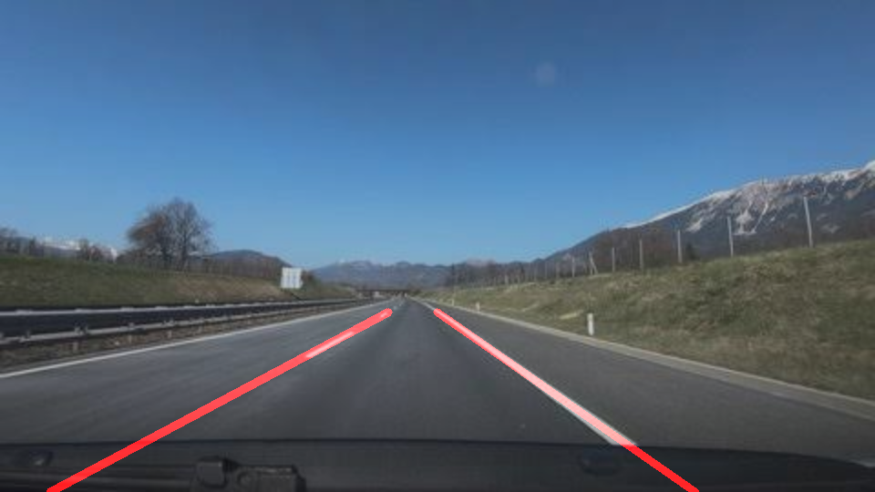
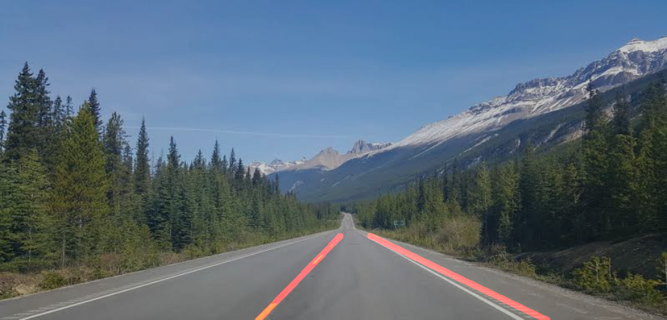
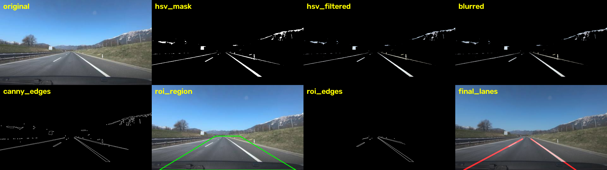
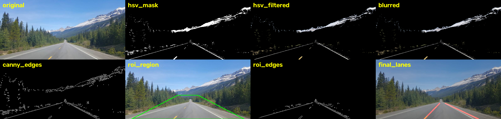

# Lane Line Extractor (Classical Computer Vision)

A lane line extractor built with **OpenCV** and **NumPy**. It processes static road images and isolates highway lane lines using only classical computer vision techniques (no deep learning). This is the groundwork for a perception system.

## Results

### Test 1: mountain highway (`test1.jpeg`)

| Input | Extracted lane lines |
|-------|----------------------|
|  |  |

### Test 2: highway with guardrail (`test2.jpeg`)

| Input | Extracted lane lines |
|-------|----------------------|
|  |  |

In both images the red lines follow the dashed center line on the left and the solid white edge line on the right, so the lane the car is driving in is outlined. The trees, mountains, sky, and guardrail are ignored because of the color filter and the ROI mask.

### Full pipeline (all 8 stages)




> The script saves every stage to the `output/` folder after each run. Put `test1.jpeg` and `test2.jpeg` in `test_images/` and commit the `output/` files so the images show on GitHub.

## How it works

Each image goes through this pipeline:

1. **Load and resize**: the image is loaded with OpenCV and resized to a standard width of 960 px so the settings behave the same on every image.
2. **HSV color filtering**: the image is converted from BGR to HSV and only **white** and **yellow** pixels are kept (the colors of lane paint). HSV separates color from brightness, so it is much more robust to lighting changes than filtering in BGR. The white brightness threshold is chosen automatically from the road area (97th percentile of brightness), or you can set it by hand.
3. **Gaussian blur**: reduces noise so that Canny does not detect false edges.
4. **Canny edge detection**: finds the boundaries of the filtered lane paint (default thresholds 50 / 150).
5. **Region of Interest (ROI) mask**: a trapezoid in front of the camera keeps only the road area and removes sky, trees, and buildings.
6. **Lane line fitting (extra)**: a probabilistic Hough transform finds line pieces. They are split into left and right by slope, averaged (longer pieces count more), and drawn in red on the original image. The lines stop at the vanishing point to avoid an "X" shape.

## Pipeline stages saved to `output/`

| File suffix | Description |
|-------------|-------------|
| `_1_original` | Resized input image |
| `_2_hsv_mask` | Binary white + yellow mask |
| `_3_hsv_filtered` | Original image with only white/yellow pixels |
| `_4_blurred` | After Gaussian blur |
| `_5_canny_edges` | Canny edge map |
| `_6_roi_region` | ROI trapezoid drawn on the image |
| `_7_roi_edges` | Edges inside the ROI only |
| `_8_final_lanes` | Detected lane lines drawn on the image |
| `_pipeline_grid` | All 8 stages in one picture |

## Installation

Requires Python 3.8+.

```bash
git clone https://github.com/<your-username>/<your-repo>.git
cd <your-repo>
pip install opencv-python numpy
```

## Usage

```bash
python lane_extractor.py
```

The program is interactive:

1. Enter the path of an image or a folder of images (`q` to quit).
2. Choose whether to customize the settings (`y` / `N`).
3. The stages are saved to `output/` and shown in a window (press any key to close it).
4. After each image: `Enter` = next image, `r` = retune settings for this image, `q` = quit.

Supported formats: `.jpg`, `.jpeg`, `.png`, `.bmp`, `.webp`. Landscape road photos taken from the driver's point of view work best.

## Settings

| Setting | Default | Meaning |
|---------|---------|---------|
| `horizon` | 0.60 | Height of the ROI top edge (0 = top of image, 1 = bottom). Range 0.4 to 0.85 |
| `white_v` | auto | White brightness threshold (0 to 255) |
| `blur` | 5 | Gaussian blur kernel size (must be odd) |
| `canny_low` | 50 | Canny lower threshold |
| `canny_high` | 150 | Canny upper threshold |

### Tuning tips

- Lane lines missing: lower `white_v` or `canny_low`, or move `horizon` up.
- Too much noise or false lines: raise `canny_low`/`canny_high`, increase `blur`, or move `horizon` down.
- Strong shadows or very bright roads: set `white_v` manually.

## Project structure

```
.
├── lane_extractor.py     # main script
├── README.md
├── test_images/          # your road images
└── output/               # generated results and screenshots
```

## Limitations

- Works on static images only (no temporal smoothing like in video).
- Assumes a roughly straight road and a forward-facing camera; sharp curves are approximated by straight lines.
- The fixed ROI trapezoid assumes the camera is centered and the horizon is near the middle of the image.
- Performance drops in heavy shadows, night scenes, rain, or faded paint.

## Possible improvements

- Perspective (bird's-eye) transform with polynomial curve fitting for curved lanes.
- Adaptive ROI based on the detected vanishing point.
- Temporal smoothing for video input.
- Evaluation against a labeled dataset (for example TuSimple).

## Resources

- [FreeCodeCamp: OpenCV Course - Full Tutorial for Beginners](https://www.freecodecamp.org/)
- [Towards Data Science: Canny Edge Detection Step-by-Step in Python](https://towardsdatascience.com/)
- [OpenCV Docs: Image Processing Tutorials](https://docs.opencv.org/)

## Author

Your Name — Classical Computer Vision assignment, submitted 26/10/2026.
